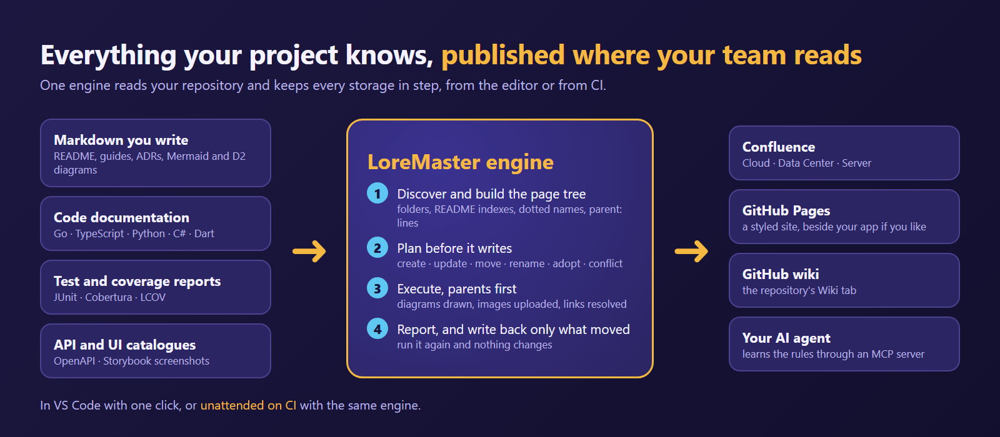
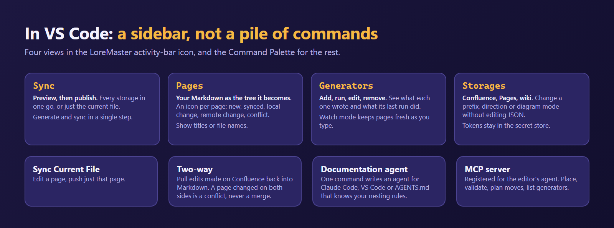
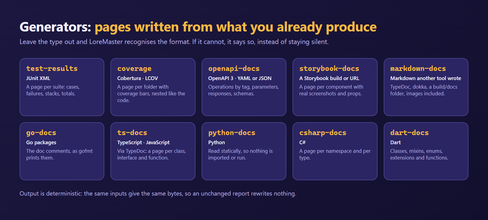
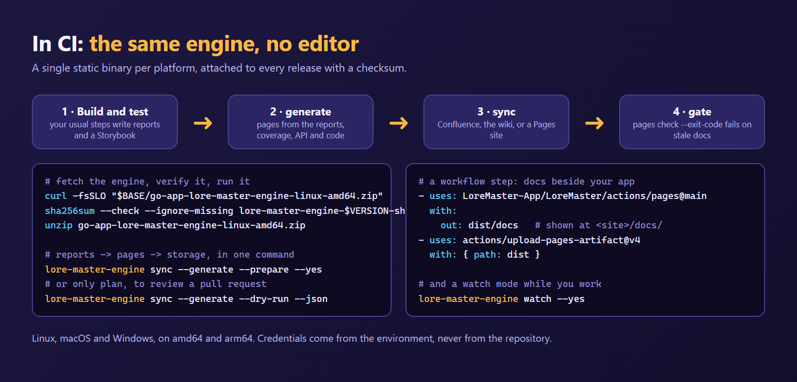
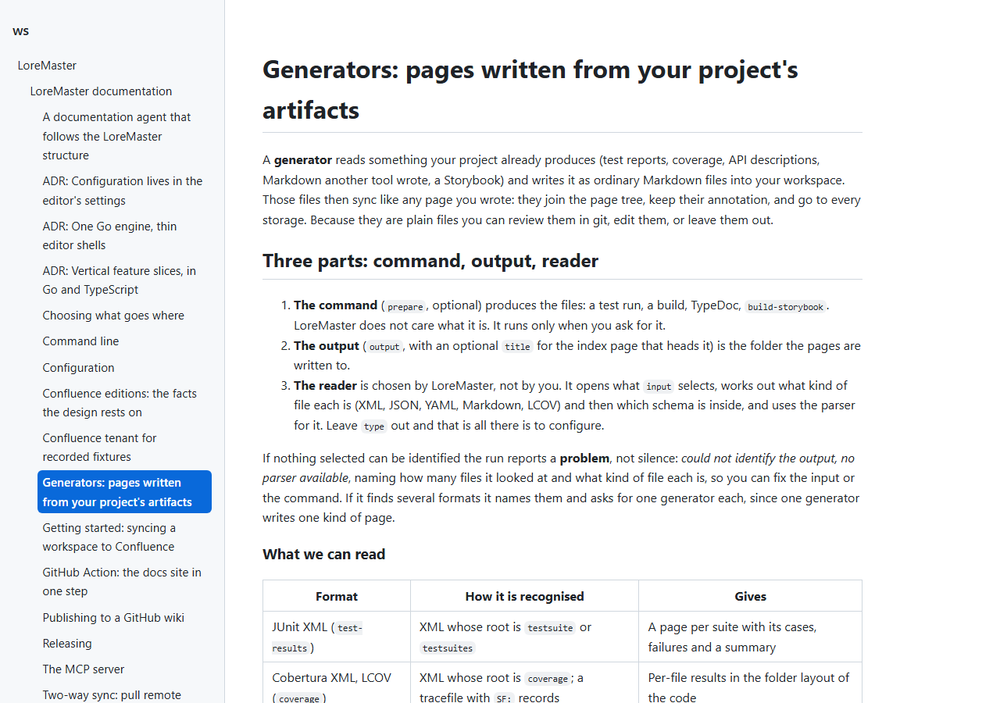

# LoreMaster


**Your project already knows everything your team needs to read. LoreMaster publishes it.**

Write Markdown in your repository. LoreMaster turns it into a clean page tree on **Confluence**
(Cloud, Data Center, Server), a styled **GitHub Pages** site or your **GitHub wiki**, and keeps
it in step on every run, from **VS Code** or unattended on **CI**. Add *generators* and the
pages that nobody wants to write by hand write themselves: **test results, code coverage,
API reference, Go, TypeScript, Python, C# and Dart documentation, and a Storybook with real
screenshots**.

[](https://marketplace.visualstudio.com/items?itemName=LoreMaster.loremaster)
[](https://marketplace.visualstudio.com/items?itemName=LoreMaster.loremaster)
[](https://github.com/LoreMaster-App/LoreMaster/releases)
[](LICENSE)



> **Preview.** The engine and its libraries are built and tested; the extension is on the
> Marketplace as a preview (`LoreMaster.loremaster`) while the end-to-end sync is hardened. See
> [`ROADMAP.md`](ROADMAP.md).

---

## Why LoreMaster

| You have | You get |
|---|---|
| Docs in the repo, and a wiki nobody updates | **One source of truth.** The folder tree is the page tree; the first `# H1` is the title; links, images and diagrams come along. |
| Fear of a tool that overwrites other people's work | **A plan before every write**, and a page edited on the platform since the last sync is a *conflict*, never overwritten. |
| Reports that live and die in CI logs | **Pages written from them**: JUnit results, coverage by folder, OpenAPI operations, a component gallery. |
| Docs that drift from the code | **Watch mode**: edit a doc comment and the page is updated seconds later, scoped to what changed. |
| AI agents that put files anywhere | **An MCP server** that tells the agent where a page nests, plans reorganisations, and lists what is generated. |
| A pipeline that must prove the docs are fresh | **`pages check --exit-code`** fails the build when the published site is out of date. |

## Install and run it in a minute

1. Install **LoreMaster** from the VS Code Marketplace (`LoreMaster.loremaster`). The engine is
   bundled; there is nothing else to install.
2. Open a folder with Markdown and run **LoreMaster: Sync**. It asks where to publish, shows the
   plan, then writes.
3. Add a generator from the **Generators** view when you want test results, coverage or API
   pages. Then run it, or turn on `loreMaster.generateBeforeSync`.

Step by step, with Confluence connection screens: [`docs/getting-started.md`](docs/getting-started.md).

## In the editor



- **Preview, then publish.** The plan lists every page as *create, update, move, rename, adopt,
  unchanged or conflict* before anything is written.
- **The Pages view** shows your Markdown as the tree it becomes, with an icon per page: new, synced,
  local changes, remote changes, conflict. Name pages by title or file name.
- **Many storages at once.** One Sync fans out across Confluence, GitHub Pages and the wiki. Send
  some pages to one and some to another with exclude and include lists
  ([`docs/choosing-what-goes-where.md`](docs/choosing-what-goes-where.md)).
- **Two-way for Confluence.** Pull edits made on the platform back into Markdown; a page changed on
  both sides is reported, never merged.
- **A documentation agent in one command.** *Create documentation agent* writes a Claude Code
  subagent, a VS Code custom agent or an `AGENTS.md` block that knows your nesting rules
  ([`docs/agent.md`](docs/agent.md)).
- **CI in one command.** *Add to your CI pipeline* reads your settings, detects GitHub Actions or
  Azure Pipelines, and opens a guide with the pipeline file and the secrets to create
  ([`docs/cli.md`](docs/cli.md#the-ci-session)).
- **No YAML to hand-edit.** Storages and generators are added, edited and removed from their views;
  your comments in the settings file survive.

## Generators: pages from what you already produce



A generator reads something your project already makes and writes ordinary Markdown pages that sync
like any other. **Leave `type` out and LoreMaster recognises the format** (XML, JSON, YAML, Markdown,
LCOV, then the schema inside). If it cannot, it reports *could not identify the output, no parser
available* rather than staying silent.

```jsonc
// .vscode/settings.json
"loreMaster.generators": [
  { "prepare": "npm run test:ci",       "input": ["reports/"],        "output": "docs/tests",      "title": "Test results" },
  { "input": ["coverage/lcov.info"],    "output": "docs/coverage",    "title": "Code coverage" },
  { "source": "storybook-static", "prepare": "npm run build-storybook",
                                         "output": "docs/components", "title": "Component library" },
  { "type": "go-docs", "output": "docs/api" }
]
```

Everything that can be read, how it is recognised and what it writes: [`docs/generators.md`](docs/generators.md).

## On CI: the same engine, no editor



The engine is also a command line, shipped as a static binary for Linux, macOS and Windows
(amd64 and arm64) on every [release](https://github.com/LoreMaster-App/LoreMaster/releases), with a
checksum file.

```bash
lore-master-engine generate --prepare            # reports, coverage, API, code -> Markdown
lore-master-engine sync --generate --yes         # ...and onto Confluence / the wiki
lore-master-engine pages build --out dist/docs   # a Pages site, no git, no network
lore-master-engine pages check --exit-code       # fail the build when the docs are stale
lore-master-engine watch --yes                   # keep it fresh while you work
```

Or use the **GitHub Action** to publish a docs site beside your web app in one step
([`docs/github-action.md`](docs/github-action.md)). Commands, flags and exit codes:
[`docs/cli.md`](docs/cli.md); live updates: [`docs/watch.md`](docs/watch.md).

## Diagrams that just work

Fence a diagram as ` ```mermaid ` or ` ```d2 ` and it is drawn for the platform: **Mermaid** by the
editor's webview, **D2** by the engine itself (so it also works on CI, with no browser, and always
draws the same SVG). On Confluence the SVG is attached and the source kept in a code macro; on GitHub
Pages it is shown inline.

## A real site from your docs

LoreMaster builds a Pages site from your Markdown with a sidebar that mirrors the page tree. This is
this repository's own documentation, built by `lore-master-engine pages build`:



## Teach your AI agent the rules

The engine is also an **MCP server** (registered for VS Code's agent automatically). Its tools let
an agent behave like someone who has read your docs:

| Tool | The agent can |
|---|---|
| `loremaster_nesting_rules` | learn how pages nest and are titled |
| `preview_tree` | see the page tree that exists right now |
| `place_document` | find the file path and parent for a new page |
| `validate_document` | check a file: where it nests, title clashes, missing H1 |
| `plan_moves` | reorganise: see what must move with a file and where each page will nest |
| `list_generators` | know which folders are generated (and so must not be edited by hand) |
| `site_publishing_plan`, `preview_site` | wire the Pages site beside an app deploy and check it builds |

Setup and examples: [`docs/mcp-server.md`](docs/mcp-server.md).

---

## How the sync works

1. **Discover & build the tree.** Find `.md` files (roots and excludes from
   the `loreMaster.*` settings), parse them with goldmark, take the title from the first `# H1`,
   and build the hierarchy. A page's parent is decided, in order, by: an explicit
   `parent:` in the file's annotation → a **dotted filename**
   (`readme.architecture.md` nests under `readme.md`) → a **directory index**
   (`README.md`) → the Confluence parent page you selected.
2. **Plan.** For each file, compare the `<!-- lore-master … -->` annotation against the
   file and the remote page, and choose one action:
   `create · update · move · rename_title · adopt · unchanged · conflict · orphan`.
3. **Execute.** Parents first, so a new page's id is known before its children are made:
   render Mermaid through the editor, upload changed attachments, create/update the page in
   Confluence **storage format**. Links are emitted as `ri:page` references by the target's
   prefixed title, so cycles resolve without a second pass (an opt-in `linkMode: id` is the
   only case that re-renders).
4. **Write back & report.** Update the annotation only in files whose page changed, then
   report every outcome.

### Page titles

Every page is titled `<titlePrefix>: <H1>`. The prefix is asked once on the first sync
(defaulting to the selected parent page's title). Confluence titles are unique per space,
so a clash is handled by `titleCollision`: `adopt` takes over an untracked page with the
same title (fine in a space you own), `fail` refuses to touch pages the sync did not make
(use this in a shared space).

### Diagrams: Mermaid and D2

Two diagram languages are understood, each as a fenced code block (` ```mermaid ` or
` ```d2 `). Confluence has native support for neither, so `mermaidMode` chooses how they appear:

- `image` (default) — the diagram is drawn to SVG, uploaded as an attachment and shown with
  its source kept in a code macro. Portable across platforms.
- `code` — leave it as a fenced code block.
- `html-macro` / `marketplace-macro` — Mermaid only, where your site enables them.

**Mermaid** is drawn by the editor's webview. **D2** is drawn by the engine itself, so it also
works from the command line and on CI, with no browser, and the same diagram always draws the
same SVG. On GitHub Pages a D2 diagram is drawn at build time and shown as an image; Mermaid is
drawn by the visitor's browser. D2 has no `html-macro` mode: outside `code` it is always an image.

## Authentication

Credentials never touch this repository or your settings files. They live in the editor's
**secret store** and travel to the engine per session over stdio.

| Edition | Credential |
|---|---|
| **Cloud** | Atlassian account email + API token |
| **Data Center** | personal access token (≥ 7.9) |
| **Server** (EOL) | personal access token (≥ 7.9), else user name + password |

## Configuration: the editor's settings

LoreMaster is configured in your editor's settings, under `loreMaster.*`, with descriptions, allowed
values and defaults in the Settings UI (**LoreMaster: Open settings**). Settings layer
**folder > workspace > user**, so a Confluence address set once in your user settings serves every
workspace. The sync reads the folder's `.vscode/settings.json`, for example:

```jsonc
{
  "loreMaster.confluence.baseUrl": "https://your-site.atlassian.net/wiki",
  "loreMaster.skipGitignored": true,    // default; leave out .md files your .gitignore files ignore
  "loreMaster.ignore": [],               // gitignore-style patterns every output leaves out, e.g. ["drafts/**", "NOTES.md"]
  "loreMaster.outputs": [
    {
      "platform": "confluence",
      "space": "DOCS",
      "parentPageId": "123456",        // the page everything nests under
      "titlePrefix": "LoreMaster",     // pages are titled "<prefix>: <H1>"
      "direction": "to-platform",      // to-platform (push) | two-way (also pull remote edits back)
      "mermaidMode": "image",          // image | code | html-macro | marketplace-macro
      "titleCollision": "adopt",       // adopt | fail
      "linkMode": "title",             // title | id
      "content": [{ "type": "markdown", "roots": ["docs"], "excludes": [], "template": "default" }]
    }
  ]
}
```

The guide, with the layers, the command line and the GitHub Action, is
[`docs/configuration.md`](docs/configuration.md). A workspace that still has a `.lore-master.yaml` is
imported into the folder's settings the first time the extension activates.

`loreMaster.skipGitignored` (default `true`) skips Markdown that the workspace's `.gitignore` files (nested ones
included) ignore — usually drafts, vendored copies or build output; set it to `false` to sync them. `loreMaster.ignore`
is a list of gitignore-style patterns, matched against workspace-relative paths, that every output leaves out
on top of its own `content[].excludes`. `node_modules`, `.git`, `dist`, `out-tsc`, `coverage` and `.venv` are
always skipped.

`direction: two-way` also pulls edits made on the platform back into the Markdown (a page
changed on both sides is reported as a conflict, never merged). Other reserved values (more
content types, templates) are present in the schema but refused until built.

## Architecture

LoreMaster is **one Go engine** — a sidecar binary spoken to over **JSON-RPC on stdio** —
wrapped by a thin editor shell per editor. The shell handles UI, secrets, and the browser;
the engine does all the Confluence work. This keeps the sync identical everywhere and the
shells small. The rationale and rejected alternatives are in
[`docs/architecture/engine-and-shells.md`](docs/architecture/engine-and-shells.md).

Dependency direction (enforced by the Go compiler):

```
lore-master-engine → documentation-sync → { markdown-workspace, confluence-client }
```

`documentation-sync` owns the `DocumentationPlatform` and `DiagramRenderer` ports and a
`confluenceplatform` adapter; a second platform is just another adapter.
`confluence-client` knows nothing about the engine.

Code is organised in **vertical feature slices** (capability → cohesive subfeature →
role-suffixed files) in both Go and TypeScript —
[`docs/architecture/vertical-feature-slices.md`](docs/architecture/vertical-feature-slices.md).

## Repository layout

```
LoreMaster/                         one root go.mod, module "lore-master"
├── apps/
│   ├── lore-master-engine/         Go: the JSON-RPC sidecar (main.go + slice packages)
│   └── lore-master-vscode/         VS Code extension (TypeScript)
├── libs/                           Go internal libraries
│   ├── markdown-workspace/         understand a folder of .md files
│   ├── confluence-client/          talk to any Confluence edition
│   ├── documentation-sync/         reconcile a workspace with a platform (owns the ports)
│   ├── content-generation/         the generators: reports, coverage, API, Storybook, code docs
│   └── github-pages/               build and publish the static site
├── tools/slicecheck/               Go test enforcing the file-role rules
├── docs/                           architecture and contributing docs
├── CLAUDE.md, ROADMAP.md
└── (files owned by @mnci/cli: nx.json, eslint config, CI, …)
```

## Developing

Prerequisites: **Node** (for the Nx workspace and the TypeScript shell) and **Go** (for the
engine and libraries). The monorepo is managed with
[`@mnci/cli`](https://github.com/russoedu/MoNecromanCi) (Nx under the hood).

```bash
npm run lint      # ESLint (TS) + golangci-lint (Go) + tools/slicecheck
npm run test      # jest + go test ./...
npm run build     # engine binaries + extension bundle
npm run format    # eslint --fix (there is no Prettier)
```

Debug the extension with the **`lore-master-vscode: debug`** launch entry (an Extension
Development Host). Package the VSIX and stamped engine binaries with
`npx nx run lore-master-vscode:package`.

### Testing

Every library is unit-tested. The whole sync is additionally covered end to end, with **no
real tenant and no network**, by a hermetic integration test
(`libs/documentation-sync/remotesync`): it drives the real adapter and HTTP client through
the real plan/execute use cases against an in-process fake Confluence, asserting page
creation, annotation write-back, an idempotent re-run, and page adoption.

## Contributing

- **Every step is a GitHub issue before it is built** — the issues are the durable record;
  `CLAUDE.md` and `ROADMAP.md` only index them.
- **Conventional commits** (enforced by commitlint); **merge commits only** (never squash
  or rebase).
- Releases are automated: a merge to `main` versions the extension from the commit history
  and publishes it to the Marketplace through Microsoft Entra ID (OIDC — no stored secret).
  The same packages go to Open VSX (VSCodium, Cursor, Windsurf, Gitpod) when the `OVSX_PAT`
  secret exists; create the `LoreMaster` namespace once with `npx ovsx create-namespace`.

See [`docs/`](docs/) for architecture and contributing guides, and
[`ROADMAP.md`](ROADMAP.md) for every epic and its issues.

## License

See [`LICENSE`](LICENSE).
